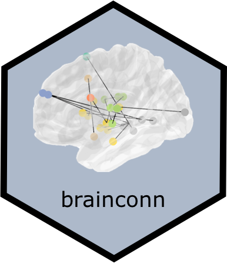
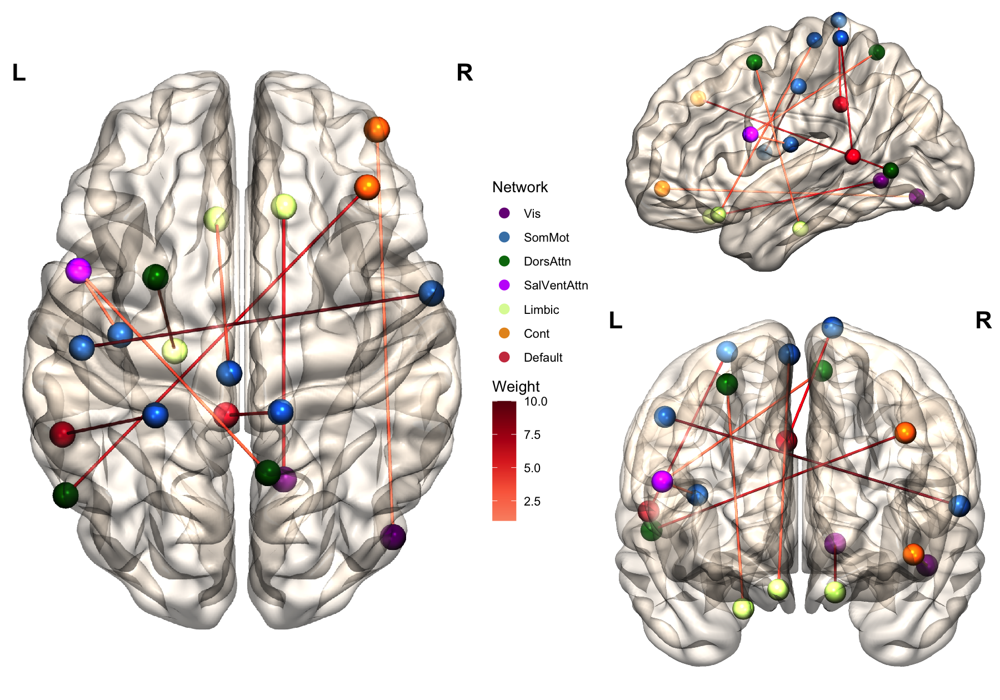
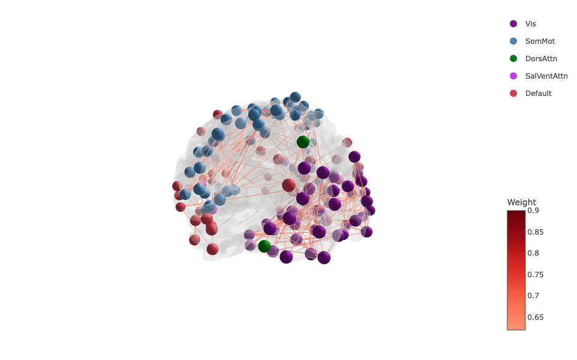
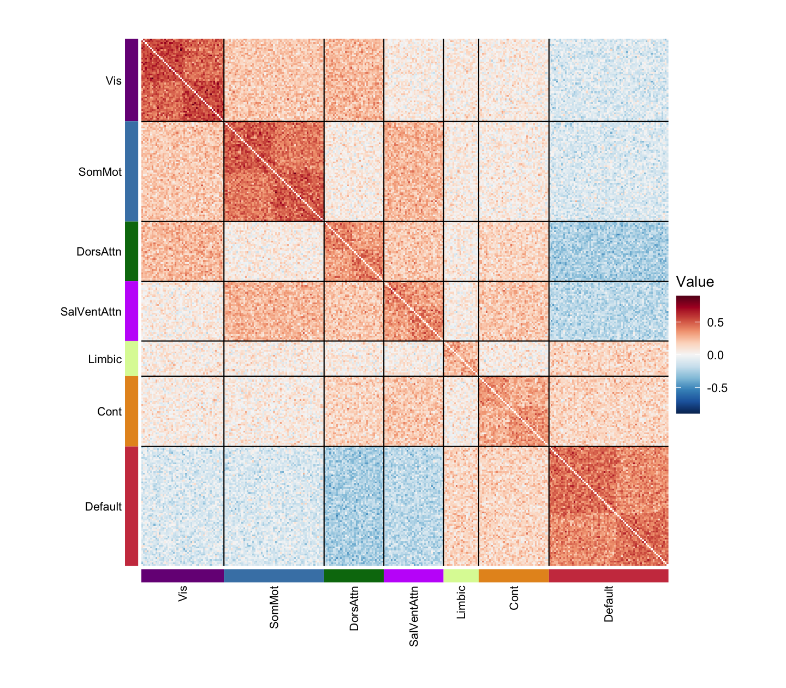
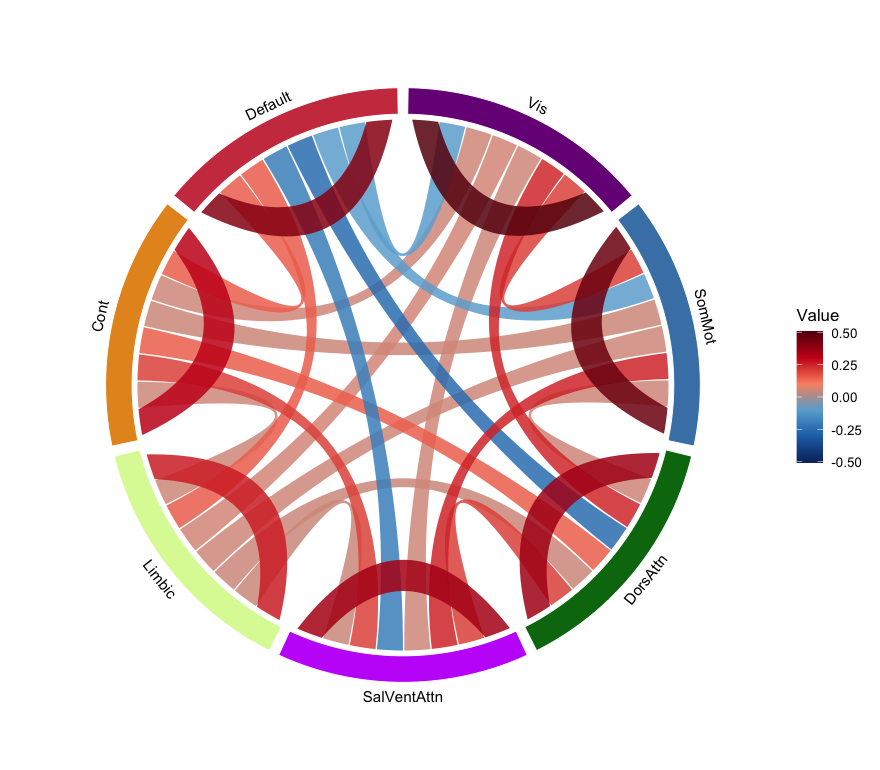
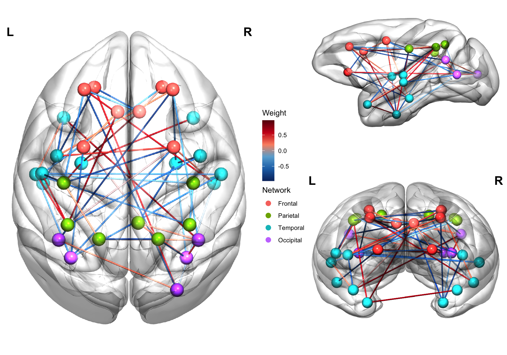

# brainconn 

<!-- badges: start -->

[](https://github.com/sidchop/brainconn/actions/workflows/R-CMD-check.yaml)
<!-- badges: end -->

brainconn makes publication-ready plots of brain connectivity data in R,
so that visualisation can be part of reproducible analysis scripts:

- `brainconn()`: static 3D renders of brain networks in the style of
  BrainNet Viewer, as ggplot objects.
- `brainconn3D()`: interactive 3D plots; hover over a node to see its
  connections, and click it to highlight them.
- `brainconn_matrix()`: connectivity matrices grouped by network, with
  network borders, smoothing and network-level summaries.
- `brainconn_circle()`: chord diagrams of connectivity within and
  between networks.
- `brainconn2d()`: 2D plots over a brain image (the `brainconn()` of
  versions before 1.0.0).

Many commonly used atlases are included (see `list_atlases()`), and you
can use your own atlas and your own brain mesh. Rat and macaque brains
are included too.

Start with the [Getting
started](https://sidchop.github.io/brainconn/articles/brainconn.html)
guide, then [A guide to every
function](https://sidchop.github.io/brainconn/articles/guide.html),
[Custom atlases and other
brains](https://sidchop.github.io/brainconn/articles/other-brains.html)
and [Animating brain
networks](https://sidchop.github.io/brainconn/articles/animations.html).

## Installation

``` r
install.packages("remotes")
remotes::install_github("sidchop/brainconn")
```

## Citation

**If you use this package in your research, please cite:**

**Sidhant Chopra, Loïc Labache, Elvisha Dhamala, Edwina R Orchard, Avram
Holmes (2023). *A Practical Guide for Generating Reproducible and
Programmatic Neuroimaging Visualizations* ApertureNeuro.**

**<https://doi.org/10.52294/001c.85104>**

## Use

See the
[vignette](https://sidchop.github.io/brainconn/articles/brainconn.html)
(or `vignette("brainconn")`) for more examples. The main input is a
connectivity matrix, `conmat`, whose rows and columns match the regions
of an atlas.

### 3D renders

``` r
library(brainconn)
brainconn(atlas = "schaefer300_n7", conmat = example_weighted_undirected,
          view = "ortho", edge.color.weighted = TRUE, res = 1400)
```

<!-- -->

### Interactive 3D, with highlighting

``` r
brainconn3D(atlas = "schaefer300_n7", conmat = example_weighted_undirected,
            edge.color.weighted = TRUE, highlight = TRUE)
```



### Connectivity matrices

``` r
brainconn_matrix(example_fc_schaefer300, atlas = "schaefer300_n7")
```

<!-- -->

### Chord diagrams

``` r
brainconn_circle(example_fc_schaefer300, atlas = "schaefer300_n7")
```

<!-- -->

### Other brains

``` r
set.seed(3)
n <- nrow(macaque_atlas)
conmat <- matrix(0, n, n)
conmat[sample(which(upper.tri(conmat)), 50)] <- runif(50, -1, 1)
conmat <- conmat + t(conmat)
brainconn(atlas = macaque_atlas, conmat = conmat, mesh = macaque_mesh, view = "ortho",
          edge.color.weighted = TRUE, res = 1400)
```

<!-- -->

### Animations

A series of renders makes an animation, e.g. a network diffusion model
spreading from the left temporal pole (see [Animating brain
networks](https://sidchop.github.io/brainconn/articles/animations.html)):


### Report bugs or requests

Don’t hesitate to ask for support or new features using [GitHub
issues](https://github.com/sidchop/brainconn/issues).

### Other R packages you might be interested in

- [ggseg](https://github.com/ggseg/ggseg) &
  [ggseg3d](https://github.com/ggseg/ggseg3d): plotting tools for brain
  atlases, in ggplot/plotly
