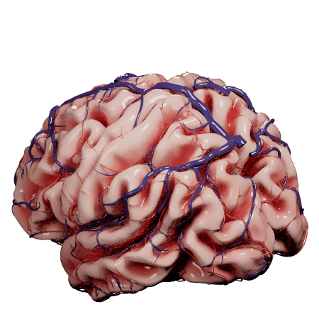

```{r setup, include = FALSE}
knitr::opts_chunk$set(collapse = TRUE, comment = "#>", message = FALSE, warning = FALSE,
                      fig.align = "center", dpi = 150)
```

This vignette makes an animation of something spreading through a brain network, the kind of process described by network spreading models of disease (e.g. the prion-like spread of misfolded proteins). `brainconn()` draws one image per time point, and the [gifski](https://cran.r-project.org/package=gifski) package joins them into a GIF.

```{r}
library(brainconn)
atlas <- schaefer300_n7
```

## The network

Spread happens along a network of connections, usually a structural connectome. Here we use a sparse, weighted stand-in made from the simulated `example_fc_schaefer300`: starting from the region where the spread begins, the left temporal pole, we add the strongest connection from a region already in the network to a new region, 80 times (this is Prim's algorithm, so the network is connected), and then the 20 strongest of the remaining connections between those regions. That makes a network of 81 regions and 100 weighted connections.

```{r}
A <- pmax(example_fc_schaefer300, 0)   # positive connections only
diag(A) <- 0
seed <- which(atlas$ROI.Name == "Limbic_TempPole_1" & atlas$hemi == "LH")
W <- matrix(0, nrow(A), ncol(A))
inside <- seed
for (k in 1:80) {
  outside <- setdiff(seq_len(nrow(A)), inside)
  best <- which(A[inside, outside, drop = FALSE] == max(A[inside, outside]), arr.ind = TRUE)[1, ]
  i <- inside[best[1]]
  j <- outside[best[2]]
  W[i, j] <- W[j, i] <- A[i, j]
  inside <- c(inside, j)
}
extra <- A[inside, inside] * (W[inside, inside] == 0)
pairs <- which(upper.tri(extra))
strongest <- pairs[order(extra[pairs], decreasing = TRUE)[1:20]]
add <- matrix(0, length(inside), length(inside))
add[strongest] <- extra[strongest]
W[inside, inside] <- W[inside, inside] + add + t(add)
sum(W[upper.tri(W)] > 0)   # number of connections
```

## The spread

A simple spreading model: the amount in each region, from 0 to 1, grows with the amount in the regions it is connected to (weighted by the connections) and with how much room it has left, `dx/dt = beta * (1 - x) * (W %*% x)`. It starts with the left temporal pole full, and is worked out in small time steps:

```{r}
times <- seq(0, 9, length.out = 30)
x <- matrix(0, nrow(W), length(times))
value <- as.numeric(seq_len(nrow(W)) == seed)
t <- 0
for (k in seq_along(times)) {
  while (t < times[k] - 1e-9) {
    value <- pmin(value + 0.02 * (1 - value) * drop(W %*% value), 1)   # beta = 1, step 0.02
    t <- t + 0.02
  }
  x[, k] <- value
}
```

## One frame

Each frame draws the network's regions and connections on the brain. Regions grow, and change from grey to their network's colour, as the spread reaches them. Connections are coloured by their weight and by the spread: they turn orange and then red once the spread has reached both of their ends, and stronger connections turn redder.

```{r}
network_colour <- network_colors(atlas$network)[atlas$network]
fade <- function(colours, amount) {   # from grey (0) to the colour (1)
  rgb <- grDevices::col2rgb(colours)
  grey <- grDevices::col2rgb("grey80")[, 1]
  grDevices::rgb(t(rgb * rep(amount, each = 3) + grey * (1 - rep(amount, each = 3))) / 255)
}
frame <- function(value, title) {
  edges <- W / max(W) * (0.15 + 0.85 * outer(value, value, pmin))   # weight x spread at both ends
  p <- brainconn(atlas = atlas, conmat = edges, view = "ortho", res = 500,
                 node.size = 3.5 + 7 * value,
                 node.color = fade(network_colour, sqrt(value)),
                 edge.color.weighted = TRUE, edge.palette = c("grey75", "grey75", "orange", "red3"),
                 edge.limits = c(0, 1), edge.alpha = 0.8, edge.width = 0.8, show.legend = FALSE)
  cowplot::plot_grid(cowplot::ggdraw() + cowplot::draw_label(title, size = 16), p,
                     ncol = 1, rel_heights = c(0.07, 1))
}
```

```{r, fig.width = 10, fig.height = 7.5, out.width = "100%"}
frame(x[, 15], sprintf("t = %.1f", times[15]))
```

## The animation

One frame per time point, joined by `gifski::save_gif()`:

```{r, eval = FALSE}
gifski::save_gif({
  for (i in seq_along(times)) print(frame(x[, i], sprintf("t = %.1f", times[i])))
}, "spread.gif", width = 900, height = 675, res = 90, delay = 0.2)
```

```{r, echo = FALSE, out.width = "100%"}
knitr::include_graphics("figures/animation-spread.gif")
```

## Other animations

Any value per region and time point works the same way, e.g. regional activity from fMRI or EEG. Here is a wave of activity sweeping from the back of the brain to the front:

```{r}
y <- (atlas$y.mni - min(atlas$y.mni)) / diff(range(atlas$y.mni))   # 0 = back, 1 = front
phases <- seq(0, 1, length.out = 25)[-25]
wave <- sapply(phases, function(p) (1 + cos(2 * pi * (y - p))) / 2)
colours <- colorRampPalette(c("grey85", "gold", "orange", "red", "darkred"))(100)
wave_frame <- function(value) {
  brainconn(atlas = atlas, all.nodes = TRUE, view = "left", res = 600, hemi.labels = FALSE,
            node.size = 3 + 9 * value, node.color = colours[1 + round(value * 99)])
}
```

```{r, eval = FALSE}
gifski::save_gif({
  for (i in seq_along(phases)) print(wave_frame(wave[, i]))
}, "wave.gif", width = 600, height = 500, res = 90, delay = 0.08)
```

```{r, echo = FALSE, out.width = "60%"}
knitr::include_graphics("figures/animation-wave.gif")
```

## A squishy brain

Just for fun: `brainconn_bounce()` drops a ball for every region of the atlas onto a path-traced realistic brain (see `brainconn(style = "realistic")`), in a white photo studio. The balls bounce off the brain, which squishes and jiggles like jelly where they land. The regions in the network stick where they land; the others roll down the brain, or bounce off it, onto the floor and away. Then the network's connections grow between the balls that stuck. Every frame is path traced, so this takes about 20 minutes; it needs the rayrender and gifski packages.

```{r, eval = FALSE}
brainconn_bounce("schaefer300_n7", example_unweighted_undirected, file = "bounce.gif",
                 res = 450, fps = 12)
```

```{r, echo = FALSE, out.width = "75%"}

```
