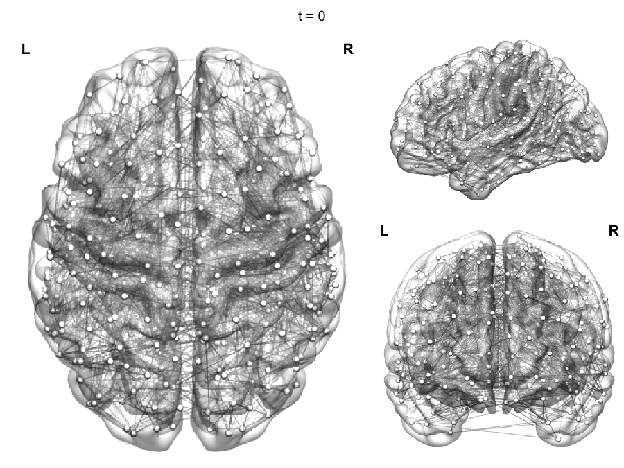
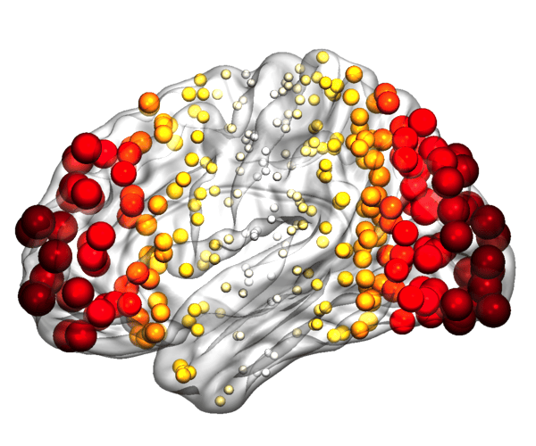

```{r setup, include = FALSE}
knitr::opts_chunk$set(collapse = TRUE, comment = "#>", message = FALSE, warning = FALSE,
                      fig.align = "center", dpi = 150)
```

This vignette makes an animation of something spreading through a brain network, the kind of process described by network diffusion models (NDM) of disease spread. `brainconn()` draws one image per time point, and the [gifski](https://cran.r-project.org/package=gifski) package joins them into a GIF.

```{r}
library(brainconn)
atlas <- schaefer300_n7
```

## The network

Spread happens along a network of connections, usually a structural connectome. Here we use a stand-in: each region keeps its 6 strongest positive connections in the simulated `example_fc_schaefer300`.

```{r}
A <- pmax(example_fc_schaefer300, 0)
diag(A) <- 0
strongest <- t(apply(A, 1, function(r) r >= sort(r, decreasing = TRUE)[6]))
A <- A * (strongest | t(strongest))
```

## The spread

In a network diffusion model, the amount in each region at time `t` is `x(t) = exp(-L * t) %*% x0`, where `L` is the network's Laplacian matrix and `x0` the starting amounts. Adding it up over time gives the total that has reached each region. Here the spread starts in the left temporal pole:

```{r}
L <- diag(rowSums(A)) - A
x0 <- as.numeric(atlas$ROI.Name == "Limbic_TempPole_1" & atlas$hemi == "LH")
e <- eigen(L, symmetric = TRUE)
total <- function(t) ifelse(e$values > 1e-9, (1 - exp(-e$values * t)) / e$values, t)
times <- seq(0, 20, length.out = 30)
x <- sapply(times, function(t) e$vectors %*% (total(t) * crossprod(e$vectors, x0)))
x <- pmin(pmax(x / max(x[x0 == 0, ]), 0), 1)   # 0 to 1: how much has arrived
```

## One frame

Each frame draws the network on the brain, semi-transparent. Regions grow, and change from grey to their network's colour, as the spread reaches them; connections turn orange and red once the spread has reached both of their ends.

```{r}
network_colour <- network_colors(atlas$network)[atlas$network]
fade <- function(colours, amount) {   # from grey (0) to the colour (1)
  rgb <- grDevices::col2rgb(colours)
  grey <- grDevices::col2rgb("grey85")[, 1]
  grDevices::rgb(t(rgb * rep(amount, each = 3) + grey * (1 - rep(amount, each = 3))) / 255)
}
frame <- function(value, title) {
  edges <- (A > 0) * (0.05 + outer(value, value, pmin))   # spread at both ends
  p <- brainconn(atlas = atlas, conmat = edges, all.nodes = TRUE, view = "ortho", res = 500,
                 node.size = 3 + 7 * value, node.color = fade(network_colour, sqrt(value)),
                 edge.color.weighted = TRUE, edge.palette = c("grey60", "grey60", "orange", "red3"),
                 edge.limits = c(0, 1), edge.alpha = 0.5, edge.width = 0.45, show.legend = FALSE)
  cowplot::plot_grid(cowplot::ggdraw() + cowplot::draw_label(title, size = 16), p,
                     ncol = 1, rel_heights = c(0.07, 1))
}
```

```{r, fig.width = 10, fig.height = 7.5, out.width = "100%"}
frame(x[, 15], sprintf("t = %.0f", times[15]))
```

## The animation

One frame per time point, joined by `gifski::save_gif()`:

```{r, eval = FALSE}
gifski::save_gif({
  for (i in seq_along(times)) print(frame(x[, i], sprintf("t = %.0f", times[i])))
}, "spread.gif", width = 900, height = 675, res = 90, delay = 0.2)
```

```{r, echo = FALSE, out.width = "100%"}

```

## Other animations

Any value per region and time point works the same way, e.g. regional activity from fMRI or EEG. Here is a wave of activity sweeping from the back of the brain to the front:

```{r}
y <- (atlas$y.mni - min(atlas$y.mni)) / diff(range(atlas$y.mni))   # 0 = back, 1 = front
phases <- seq(0, 1, length.out = 25)[-25]
wave <- sapply(phases, function(p) (1 + cos(2 * pi * (y - p))) / 2)
colours <- colorRampPalette(c("grey85", "gold", "orange", "red", "darkred"))(100)
wave_frame <- function(value) {
  brainconn(atlas = atlas, all.nodes = TRUE, view = "left", res = 600, hemi.labels = FALSE,
            node.size = 3 + 9 * value, node.color = colours[1 + round(value * 99)])
}
```

```{r, eval = FALSE}
gifski::save_gif({
  for (i in seq_along(phases)) print(wave_frame(wave[, i]))
}, "wave.gif", width = 600, height = 500, res = 90, delay = 0.08)
```

```{r, echo = FALSE, out.width = "60%"}

```
