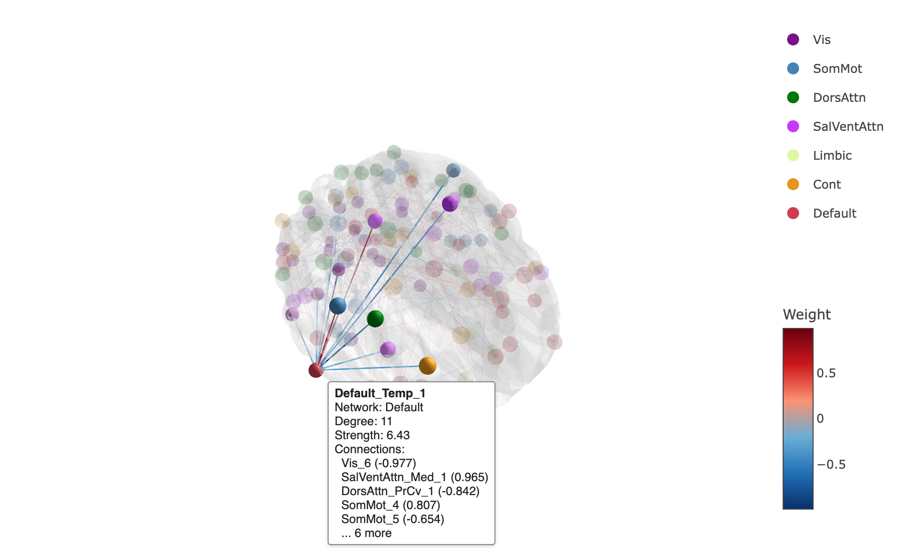

```{r setup, include = FALSE}
knitr::opts_chunk$set(collapse = TRUE, comment = "#>", message = FALSE, warning = FALSE,
                      fig.align = "center", dpi = 150)
# The realistic style is path traced with rayrender (on macOS it also needs XQuartz)
has_rayrender <- requireNamespace("rayrender", quietly = TRUE)
```

brainconn plots brain connectivity data in R, so your figures can live in the same script as your analysis. This page shows the main function, `brainconn()`, and gives a quick look at everything else. Two more guides go further:

* [A guide to every function](guide.html): step-by-step, beginner-friendly examples of every function, including connectivity matrices, chord diagrams and interactive plots.
* [Custom atlases and other brains](other-brains.html): use your own atlas or brain surface, including rat and macaque brains.
* [Animating brain networks](animations.html): make GIFs of activity or disease spreading through the brain.

## What you need

Two things:

1. **An atlas**: the brain regions (nodes) and their coordinates. brainconn includes many common atlases; see them with `list_atlases()`.
2. **A connectivity matrix**: a square matrix with one row and one column per region of the atlas, in the same order. A non-zero value in row *i*, column *j* is a connection (edge) between regions *i* and *j*. It can be binary (0/1) or weighted, and symmetric (undirected) or not (directed).

brainconn comes with example matrices for the `schaefer300_n7` atlas (300 regions in 7 networks):

```{r}
library(brainconn)
x <- example_unweighted_undirected
dim(x)
sum(x[upper.tri(x)] != 0)   # number of edges
```

## Plotting with `brainconn()`

`brainconn()` draws a static 3D render of the brain network: regions are spheres, coloured by network, and connections are tubes, inside a glass brain.

```{r, fig.width = 6, fig.height = 6, out.width = "60%"}
brainconn(atlas = "schaefer300_n7", conmat = x)
```

The result is a ggplot, so you can save it with `ggsave()`, add a title with `+ ggtitle()`, or combine it with other plots.

### Views

Use `view` to choose the angle: `"top"`, `"bottom"`, `"left"`, `"right"`, `"front"`, `"back"`, `"ortho"` (three views), `"all"` (six views), or any camera angle as `c(azimuth, elevation)`. In the top, bottom, front and back views, the left hemisphere is always on the left (marked "L").

```{r, fig.width = 10, fig.height = 7, out.width = "100%"}
brainconn(atlas = "schaefer300_n7", conmat = x, view = "ortho")
```

```{r, fig.width = 6, fig.height = 5, out.width = "60%"}
brainconn(atlas = "schaefer300_n7", conmat = x, view = c(-120, 20))
```

### Weighted and directed connections

For weighted matrices, the edge width shows the weight. Set `edge.color.weighted = TRUE` to colour edges by weight instead. Directed matrices get arrowheads.

```{r, fig.width = 7, fig.height = 5.5, out.width = "70%"}
brainconn(atlas = "schaefer300_n7", conmat = example_weighted_undirected, view = "left",
          edge.color.weighted = TRUE, edge.width = 1.5)
```

### Changing the look

Most parts of the plot can be changed: node size and colour, edge colour and width, the brain's colour and opacity, labels, and image size. For example:

```{r, fig.width = 7, fig.height = 5.5, out.width = "70%"}
brainconn(atlas = "schaefer300_n7", conmat = x, view = "right",
          node.size = 6, node.color = "darkorange", edge.color = "grey30",
          mesh.color = "lightsteelblue", mesh.alpha = 0.4, labels = TRUE)
```

See `?brainconn` for every option, and [the guide](guide.html#brainconn) for more examples.

### Experimental: a realistic brain

`style = "realistic"` path traces a wet, glistening brain with blood vessels on its surface (with the [rayrender](https://www.rayrender.net) package), and draws the network glowing through it. It takes about 20 seconds per view.

```{r, fig.width = 8, fig.height = 5.5, out.width = "85%", dev.args = list(bg = "grey5"), eval = has_rayrender}
brainconn(atlas = "schaefer300_n7", conmat = x, view = c(-125, 25), style = "realistic")
```

## Everything else, at a glance

### Interactive 3D: `brainconn3D()`

An interactive plot you can rotate and zoom. Hover over a node to see its connections; with `highlight = TRUE`, click a node to keep only its connections in view.

```{r, eval = FALSE}
brainconn3D(atlas = "schaefer300_n7", conmat = x, highlight = TRUE)
```

```{r, echo = FALSE, out.width = "85%"}

```

[More on interactive plots](guide.html#brainconn3d)

### Connectivity matrices: `brainconn_matrix()`

A heatmap of the whole matrix, with regions grouped by network. `example_fc_schaefer300` is a simulated functional connectivity matrix.

```{r, fig.width = 7, fig.height = 6, out.width = "65%"}
brainconn_matrix(example_fc_schaefer300, atlas = "schaefer300_n7")
```

[More on matrices](guide.html#matrices)

### Chord diagrams: `brainconn_circle()`

Connectivity within and between networks, as a circle.

```{r, fig.width = 7, fig.height = 6, out.width = "65%"}
brainconn_circle(example_fc_schaefer300, atlas = "schaefer300_n7")
```

[More on chord diagrams](guide.html#chords)

### 2D plots: `brainconn2d()`

The 2D plots of earlier versions of brainconn (before 1.0.0, this was `brainconn()`).

```{r, fig.width = 6, fig.height = 6, out.width = "50%"}
brainconn2d(atlas = "schaefer300_n7", conmat = x, view = "top")
```

### Other brains

Any brain surface works, as long as the atlas is in the same space. brainconn includes a rat and a macaque brain:

```{r, fig.width = 7, fig.height = 5, out.width = "70%"}
set.seed(1)
rat_conmat <- matrix(0, nrow(rat_atlas), nrow(rat_atlas))
rat_conmat[sample(which(upper.tri(rat_conmat)), 40)] <- 1
rat_conmat <- rat_conmat + t(rat_conmat)
brainconn(atlas = rat_atlas, conmat = rat_conmat, mesh = rat_mesh, view = c(-60, 30))
```

[More on custom atlases and other brains](other-brains.html)

### Animations

A series of `brainconn()` images makes an animation, e.g. a disease process spreading from one region through the network:

```{r, echo = FALSE, out.width = "100%"}
knitr::include_graphics("figures/animation-spread.gif")
```

[How to make animations](animations.html)
