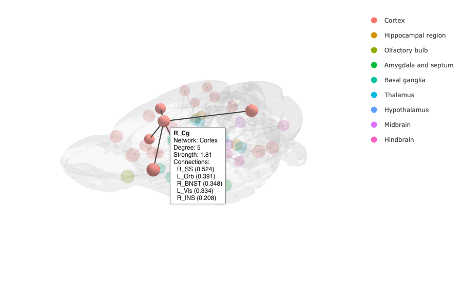

```{r setup, include = FALSE}
knitr::opts_chunk$set(collapse = TRUE, comment = "#>", message = FALSE, warning = FALSE,
                      fig.align = "center", dpi = 150)
# The realistic style is path traced with rayrender (on macOS it also needs XQuartz)
has_rayrender <- requireNamespace("rayrender", quietly = TRUE)
```

brainconn isn't limited to the included atlases or to the human brain. This page shows how to use your own atlas, your own brain surface, and the rat and macaque brains that come with brainconn.

```{r}
library(brainconn)
```

## Your own atlas

An atlas is a data.frame with one row per region and at least these columns:

* `ROI.Name`: the region's name
* `x.mni`, `y.mni`, `z.mni`: the region's centre (in MNI space for the included human brain)

Optional columns: `network` to colour and group regions, and `hemi` ("LH"/"RH") to order regions by hemisphere in matrices.

Region centres are sometimes published with an atlas. Otherwise they can be computed from the atlas image, e.g. with FSL (`fslstats atlas.nii.gz -K atlas.nii.gz -c`) or in R with the RNifti package. `check_atlas()` tells you whether an atlas will work:

```{r}
my_atlas <- custom_atlas_example
head(my_atlas)
check_atlas(my_atlas)
```

Then use it like any included atlas:

```{r, fig.width = 6, fig.height = 5, out.width = "60%"}
brainconn(atlas = my_atlas, conmat = example_unweighted_undirected, node.color = "black",
          view = "left")
```

## Your own brain surface

`brainconn()` and `brainconn3D()` draw the ICBM152 brain by default. Give `mesh` any other surface, e.g. an individual's FreeSurfer surfaces, a template for another species, or a surface of part of the brain. Mesh files can be GIfTI (`.gii`), FreeSurfer (`lh.pial`, `.asc`), PLY, OBJ, STL, VTK, OFF and more; separate hemispheres are combined.

```{r, eval = FALSE}
mesh <- read_brain_mesh(c("lh.pial.surf.gii", "rh.pial.surf.gii"))
mesh   # how many vertices, and the range of its coordinates
brainconn(atlas = my_atlas, conmat = my_conmat, mesh = mesh, view = "ortho")
brainconn3D(atlas = my_atlas, conmat = my_conmat, mesh = mesh, highlight = TRUE)
```

Two things to check:

* **The atlas must be in the same space as the mesh.** Compare the range of the atlas coordinates with the range printed for the mesh.
* **Coordinates should be RAS**: x increases to the subject's right, y to the front and z upwards, as in MNI space and most templates. If the views look mirrored or upside down, your coordinates use another convention.

Node and edge sizes scale with the size of the mesh, so the defaults look right for any brain.

## A rat brain

brainconn includes a rat brain from the Waxholm Space atlas of the Sprague Dawley rat (Kleven et al. 2023): `rat_mesh` is the brain surface and `rat_atlas` has 66 regions (33 per hemisphere), grouped into cortex, hippocampal region, basal ganglia, thalamus and other systems. Coordinates are in Waxholm Space (millimetres).

```{r}
head(rat_atlas[, c("ROI.Name", "name", "network", "hemi", "x.mni", "y.mni", "z.mni")])
```

Here is a random network of 60 connections, for illustration:

```{r}
set.seed(2)
n <- nrow(rat_atlas)
rat_conmat <- matrix(0, n, n)
rat_conmat[sample(which(upper.tri(rat_conmat)), 60)] <- runif(60, 0.2, 1)
rat_conmat <- rat_conmat + t(rat_conmat)
```

```{r, fig.width = 10, fig.height = 7, out.width = "100%"}
brainconn(atlas = rat_atlas, conmat = rat_conmat, mesh = rat_mesh, view = "ortho",
          edge.color.weighted = TRUE)
```

With fewer connections, region labels are readable:

```{r, fig.width = 7, fig.height = 5, out.width = "70%"}
rat_sparse <- rat_conmat * (rat_conmat > 0.75)
brainconn(atlas = rat_atlas, conmat = rat_sparse, mesh = rat_mesh, view = c(-50, 25),
          labels = TRUE)
```

The interactive plot works the same way. Here the cingulate cortex is clicked, so only its connections are shown:

```{r, eval = FALSE}
brainconn3D(atlas = rat_atlas, conmat = rat_conmat, mesh = rat_mesh, highlight = TRUE,
            show.legend = TRUE)
```

```{r, echo = FALSE, out.width = "85%"}

```

So do matrices and chord diagrams, which use the atlas's `network` column:

```{r, fig.width = 13, fig.height = 6, out.width = "100%"}
cowplot::plot_grid(
  brainconn_matrix(rat_conmat, atlas = rat_atlas, show.legend = FALSE),
  brainconn_circle(rat_conmat, atlas = rat_atlas, fun = "count", legend.title = "Edges"),
  rel_widths = c(1, 1.1))
```

## A macaque brain

`macaque_mesh` is the NIMH Macaque Template v2 (NMT v2) brain surface, and `macaque_atlas` has the 34 regions of level 2 of the Cortical Hierarchy Atlas of the Rhesus Macaque (CHARM; Jung et al. 2021), 17 per hemisphere, grouped into frontal, parietal, temporal and occipital lobes.

```{r}
head(macaque_atlas[, c("ROI.Name", "name", "network", "x.mni", "y.mni", "z.mni")])
```

```{r, fig.width = 10, fig.height = 7, out.width = "100%"}
set.seed(3)
n <- nrow(macaque_atlas)
mac_conmat <- matrix(0, n, n)
mac_conmat[sample(which(upper.tri(mac_conmat)), 50)] <- runif(50, -1, 1)
mac_conmat <- mac_conmat + t(mac_conmat)
brainconn(atlas = macaque_atlas, conmat = mac_conmat, mesh = macaque_mesh, view = "ortho",
          edge.color.weighted = TRUE)
```

```{r, fig.width = 7, fig.height = 5, out.width = "70%"}
brainconn(atlas = macaque_atlas, conmat = mac_conmat, mesh = macaque_mesh, view = "left",
          labels = TRUE, edge.color.weighted = TRUE)
```

The experimental realistic style (see [the guide](guide.html#a-realistic-brain-experimental)) grows blood vessels over any brain surface:

```{r, fig.width = 7, fig.height = 5, out.width = "70%", dev.args = list(bg = "grey5"), eval = has_rayrender}
brainconn(atlas = macaque_atlas, conmat = mac_conmat, mesh = macaque_mesh, view = c(-110, 20),
          style = "realistic", edge.color.weighted = TRUE)
```

## Where the animal brains come from

* **Rat:** Waxholm Space atlas of the Sprague Dawley rat brain, version 4 (Kleven H, et al. 2023, *Nature Methods* 20:1822-1829; Papp EA, et al. 2014, *NeuroImage* 97:374-386), CC BY 4.0. The surface was made from the atlas labels without the nerves and spinal cord.
* **Macaque:** NIMH Macaque Template v2 and CHARM (Jung B, et al. 2021, *NeuroImage* 235:117997), public domain, from TemplateFlow.

The script that made them is `data-raw/animal_meshes.R` in the package source, and is a good starting point for making your own.
